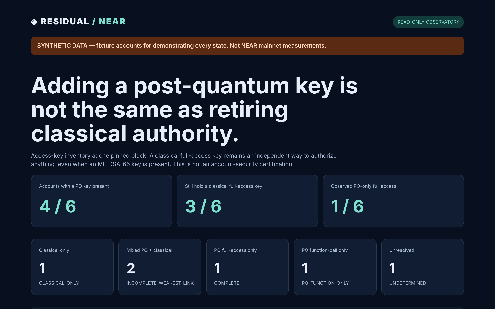

# Residual — NEAR Post-Quantum Migration Observatory

**Adding an ML-DSA-65 key is not the same as retiring classical full-access authority.** Residual is a read-only NEAR access-key scanner (Python standard library only). It reads every sampled account at one pinned block, classifies what it observes, keeps unknowns in the denominator, and writes a reproducible JSON report and a static dashboard.

Built at **NEAR HACKATHON 2026** (1–14 November). Tracks: **AI Security & Defense**, **Open Innovation**.



## Check it in two minutes

Needs Python 3.9 or later. Nothing to install, no keys, no network for steps 1–3.

| Do | See |
| --- | --- |
| `python3 -m unittest discover -s tests -v` | `Ran 40 tests` … `OK` |
| `python3 -m residual --fixture fixtures/demo.json --output demo-output` | JSON summary with `"pq_key_present": 4`, `"classical_full_access_present": 3`, `"COMPLETE": 1`, `"warnings": []` |
| Open `demo-output/index.html` in a browser | "SYNTHETIC DATA" banner; headline cards 4 / 6 with a PQ key, 3 / 6 still holding a classical full-access key, 1 / 6 PQ-only |
| `python3 -m unittest tests.test_formal_model -v` | the Python classifier matches the Lean model's truth table on all 128 input combinations |
| `python3 -m residual --sample-signers 200 --window-blocks 60 --output live-output` (needs internet) | a live NEAR mainnet sample pinned to one finalized block; see [docs/LIVE_RUN.md](docs/LIVE_RUN.md) |

The headline claim is in the demo: four of six accounts "have a post-quantum key", but only one has actually given up classical full access. A naive adoption count says four; the migration count is one.

## Why this measurement matters

NEAR's ML-DSA-65 keys ([NEP-645](https://github.com/near/NEPs/blob/master/neps/nep-0645.md), protocol version 85 / neard 2.13) were added **alongside** Ed25519 and secp256k1, which are not deprecated, and **without asset migration**. An existing account gets its first ML-DSA key through an `AddKey` signed by one of its own classical full-access keys, so an existing account that adopts post-quantum keys starts out holding both kinds. It reaches PQ-only full access only if the owner later deletes every classical full-access key. (A brand-new account can be created with only an ML-DSA key; Residual classifies it as `COMPLETE`.) Counting "accounts with a PQ key" therefore overstates migration. Residual measures both numbers separately.

## Five states (observed access-key layer only)

| State | Definition |
| --- | --- |
| `CLASSICAL_ONLY` | At least one classical full-access key, no PQ full-access key |
| `INCOMPLETE_WEAKEST_LINK` | Classical and PQ full-access keys coexist: the classical key is still an independent way in |
| `COMPLETE` | PQ full-access key(s), no classical full-access key, no unrecognized key |
| `PQ_FUNCTION_ONLY` | PQ function-call key(s) only, no full-access key |
| `UNDETERMINED` | Anything Residual cannot classify, always with a reason code (below) |

`COMPLETE` means only "observed full-access key transition". It is not a claim of quantum safety. If a `COMPLETE` account still has classical function-call keys, the report notes `RESIDUAL_CLASSICAL_FUNCTION_KEYS`.

Reason codes for `UNDETERMINED`: `ACCOUNT_NOT_FOUND`, `RPC_ERROR`, `MALFORMED_RESPONSE`, `NO_ACCESS_KEYS` (locked account), `UNRECOGNIZED_KEY`, `CLASSICAL_FUNCTION_ONLY`.

Key recognition: `ed25519:` (32 bytes), `secp256k1:` (64 bytes) and `ml-dsa-65-hash:` (32-byte SHA3-256 handle, the only ML-DSA form access-key lists return). The base58 payload is decoded and its length checked; a full `ml-dsa-65:` key inside a list is flagged as anomalous.

## Demo data

The six demo accounts in `fixtures/demo.json` are **synthetic** and the dashboard says so in a banner. They show every state; they are not NEAR measurements. To serve the dashboard instead of opening the file: `python3 -m http.server 8080 --directory demo-output`, then open http://localhost:8080.

## Live mainnet scan

Default endpoint: `https://rpc.mainnet.fastnear.com`. (`rpc.mainnet.near.org` is deprecated and limited to 30 requests per minute.) Set `FASTNEAR_API_KEY` to send a key; it is never written to the report.

**Reproducible sample (recommended):**

```bash
python3 -m residual --sample-signers 200 --window-blocks 60 --output live-output
```

This pins the latest finalized block, walks back 60 blocks, collects every distinct transaction signer, and draws 200 of them ordered by `sha256(block hash + account)`. Anyone with the report can rebuild the same frame and draw. Accounts that received an ML-DSA-65 `AddKey` inside the window (including inside meta-transactions) are read at the same block as a separate **enrollers cohort**.

**Hand-picked list (convenience sample):**

```bash
python3 -m residual --accounts my-accounts.txt --output live-output
```

Step-by-step instructions and what to record: [docs/LIVE_RUN.md](docs/LIVE_RUN.md).

## Formal model

The classifier's logic is modelled in Lean 4 with machine-checked proofs, including that adding a post-quantum key to a classical-only account can never produce `COMPLETE`. A test checks the Python code against the model on all 128 input combinations. See [formal/README.md](formal/README.md).

## What a report contains

- `report.json`: per-account state, key types, reason codes; denominators; unresolved counts by reason; provenance (chain id, protocol and node version, endpoint, pinned block height and hash, sampling frame, selection method); warnings; SHA-256 digests of the account list, raw observations and the report.
- `observations.json`: the raw access-key lists as returned by RPC.
- `index.html`: self-contained dashboard with drill-down and the full manifest.

Wilson 95% intervals appear only for a seeded random draw. They describe uncertainty within the stated frame (recent active signers), **not** all NEAR accounts.

## Boundaries

- Read-only: no signing keys, wallets, payment logic or transaction submission.
- RPC answers are trusted, not verified with light-client proofs; pinning one block gives consistency, not proof.
- A current snapshot cannot show historical key deletion, contract-based authority, recovery arrangements, validator security or off-chain signers.
- The active-signer frame over-represents bots, relayers and busy accounts. No ecosystem-wide adoption claim is made.

## Hackathon disclosure

- **When the code was written.** Every commit in this repository is dated within the build window; the first is 8 November 2026. An unpublished single-file prototype of the same idea was written in October 2026, after the hackathon was announced; none of its code is reused here.
- **Libraries and templates.** None. Python standard library only; Lean 4 (no Mathlib) for the optional formal model.
- **AI assistance.** AI coding assistants were used to write and review the code, tests and documentation. Every result in this README can be reproduced with the commands above.
- **NEAR features used.** NEP-645 ML-DSA-65 access keys (protocol 85), NEAR JSON-RPC (`view_access_key_list`, `block`, `chunk`, `status`) at a pinned finalized block, and meta-transaction (`Delegate`) parsing for the enrollers cohort.

## License

MIT, see [LICENSE](LICENSE).
